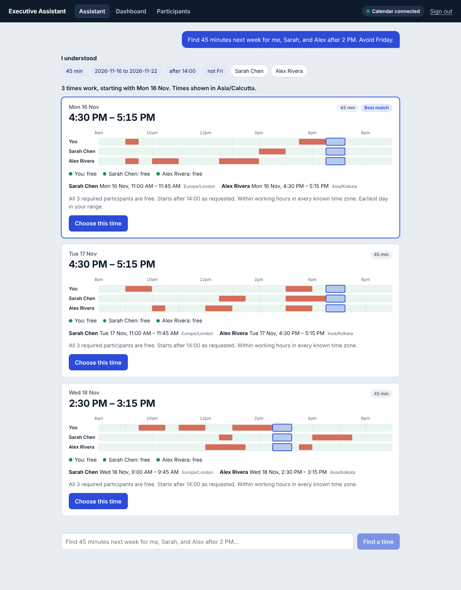

# AI-Executive-Assistant
Type a scheduling request in plain English. The assistant extracts the requirements, checks everyone's calendar availability, recommends the best three times, drafts the invitation, and creates the Google Calendar event only after you explicitly confirm.
# AI Executive Assistant — Google Calendar Auto-Resolution (MVP)

Type a scheduling request in plain English. The assistant extracts the requirements, checks everyone's calendar availability, recommends the best three times, drafts the invitation, and creates the Google Calendar event **only after you explicitly confirm**.




## Quick start (demo mode, no credentials needed)

Requires Node.js 20+ (tested on 22).

```bash
npm run install:all     # installs backend + frontend dependencies
npm start               # builds the UI, then serves everything on http://localhost:4000
```

Register an account, click **Connect Google Calendar** (in demo mode this attaches deterministic mock
calendars), and try one of the example prompts. Demo participants (Sarah, Alex, Priya, John) are pre-saved.

Development with hot reload: `npm run dev:backend` and `npm run dev:frontend` (UI on :5173, proxied to :4000).

### Going live with Google and an LLM

Copy `.env.example` to `.env`, export the variables, and restart:

| Variable | Effect |
|---|---|
| `GOOGLE_CLIENT_ID`, `GOOGLE_CLIENT_SECRET`, `GOOGLE_REDIRECT_URI`, `TOKEN_ENCRYPTION_KEY` | Switches from mock calendars to real Google OAuth 2.0 + FreeBusy + Events API |
| `ANTHROPIC_API_KEY` (+ optional `ANTHROPIC_MODEL`) | Uses an LLM for request parsing; output is schema-validated and falls back to the built-in parser on any error |
| `JWT_SECRET` | Required (32+ chars) when `NODE_ENV=production` |

In the Google Cloud console enable the Calendar API, create an OAuth client (Web), and add
`GOOGLE_REDIRECT_URI` as an authorized redirect. Scopes requested are least-privilege:
`calendar.freebusy` and `calendar.events` (plus `openid email`).

## What the MVP includes (maps to spec section 1)

| Spec | Implementation |
|---|---|
| 1.1 Authentication | Register/login/logout (bcrypt + httpOnly JWT cookie), Google OAuth with signed `state`, connection status, disconnect (revokes token) |
| 1.2 NL scheduling | `backend/src/ai`: LLM parser (optional) + deterministic rule parser; Zod-validated structured output; clarification questions |
| 1.3 Calendar integration | `calendar/googleProvider.ts` (OAuth, token refresh, FreeBusy, events, Meet, backoff) and `mockProvider.ts` |
| 1.4 Participants | CRUD, search, duplicate detection, required/optional, ambiguous-name resolution |
| 1.5–1.6 Availability + algorithm | `scheduling/engine.ts`: interval merge/invert/intersect, 15-min candidates, hard constraints, ranking |
| 1.7 Time zones | UTC instants, IANA zones via `date-fns-tz`, per-participant local times, DST-safe |
| 1.8 Recommendations | Top three (distinct days preferred) with explanation and a per-participant busy/free timeline |
| 1.9 Invitation + confirmation | Draft, edit, preview, explicit confirm, re-check before create, idempotent creation |
| 1.10 Dashboard | Profile, connection status, today/upcoming meetings, pending drafts, history |
| 1.11 Error handling | All 9 listed cases, plus rate limiting and API-failure retry (see tests) |

### Design guarantees

* The **LLM only extracts structure**. Availability, ranking and event creation are deterministic backend code.
* **Unknown availability is never treated as free.** Slots with unverified required attendees are flagged and need explicit acknowledgement.
* **No invitation is created without confirmation**, and availability is **re-checked at confirmation time**; if a slot was taken, alternatives are returned.
* **Duplicate prevention:** confirmation is idempotent (idempotency key = draft id; double-click and concurrent confirms create one event) and a second draft for the same people/time is blocked.
* **Privacy:** only busy intervals are fetched (no titles/descriptions); OAuth tokens are AES-256-GCM encrypted and never sent to the browser.

## Project layout

```

ai-executive-assistant/
│
├── backend/
│   ├── src/
│   │   ├── ai/
│   │   │   ├── schema.ts
│   │   │   ├── ruleParser.ts
│   │   │   ├── llmParser.ts
│   │   │   └── dates.ts
│   │   │
│   │   ├── scheduling/
│   │   │   └── engine.ts
│   │   │
│   │   ├── calendar/
│   │   │   ├── provider.ts
│   │   │   ├── googleProvider.ts
│   │   │   └── mockProvider.ts
│   │   │
│   │   ├── services/
│   │   │   ├── scheduling.ts
│   │   │   └── invitations.ts
│   │   │
│   │   ├── routes/
│   │   │   └── index.ts
│   │   │
│   │   ├── utils/
│   │   │   ├── intervals.ts
│   │   │   ├── timezone.ts
│   │   │   ├── crypto.ts
│   │   │   └── errors.ts
│   │   │
│   │   ├── app.ts
│   │   ├── server.ts
│   │   ├── store.ts
│   │   ├── config.ts
│   │   └── types.ts
│   │
│   └── tests/
│       ├── ai.test.ts
│       ├── ruleParser.test.ts
│       ├── llmParser.test.ts
│       ├── scheduling.test.ts
│       ├── calendar.test.ts
│       ├── invitations.test.ts
│       ├── timezone.test.ts
│       ├── routes.test.ts
│       └── integration.test.ts
│
├── frontend/
│   └── src/
│       ├── App.tsx
│       ├── components/
│       │   ├── Dashboard/
│       │   ├── ChatAssistant/
│       │   ├── Calendar/
│       │   ├── MeetingScheduler/
│       │   ├── Availability/
│       │   ├── Invitations/
│       │   └── Notifications/
│       │
│       ├── lib/
│       │   ├── api.ts
│       │   ├── dateUtils.ts
│       │   └── types.ts
│       │
│       └── styles.css
│
├── database/
│   └── prisma/
│       └── schema.prisma
│
├── e2e/
│   └── run_e2e.py
│
├── screenshots/
│
├── docs/
│   └── TEST-REPORT.md
│
├── .env.example
├── .gitignore
├── package.json
├── tsconfig.json
├── README.md
└── docker-compose.yml

```

## API summary

`POST /api/auth/register|login|logout`, `GET /api/auth/me` · `POST /api/calendar/connect`, `GET /api/calendar/status`,
`DELETE /api/auth/google/disconnect`, `POST /api/calendar/freebusy`, `GET /api/auth/google[/callback]` ·
`GET|POST|PATCH|DELETE /api/participants` · `POST /api/scheduling/request`, `/parse`, `GET /history`, `GET /:id`, `POST /:id/retry` ·
`POST /api/invitations/draft`, `GET|PATCH /:id`, `POST /:id/confirm|cancel` · `GET /api/meetings` · `GET|PATCH /api/preferences`.
Errors are always `{ "error": { "code", "message", "details?" } }`.

## Testing

```bash
npm run typecheck      # backend + frontend
npm test               # 118 backend + 6 frontend unit/integration tests
npm start &            # then, in another shell (needs `pip install playwright`):
PLAYWRIGHT_BROWSERS_PATH=... npm run test:e2e http://localhost:4000   # 23 browser checks + screenshots
```

See `docs/TEST-REPORT.md` for results and `screenshots/` for the captured UI.

## Known limitations and honest notes

* **Storage is in-memory** (data resets on restart). The PostgreSQL/Prisma model is provided in
  `database/prisma/schema.prisma`, but Prisma is not wired in; replace `store.ts` with Prisma repositories to persist data.
* **Real Google OAuth and real LLM calls were not exercised** (no credentials in the build environment). They are covered by
  unit tests with stubbed `fetch` (request shapes, scopes, token refresh, revoked access, backoff, idempotent create,
  JSON validation/fallback). Do a manual smoke test with your own credentials before relying on them.
* The mock calendar generates data in the organizer's time zone for every address; `@private.example` addresses simulate inaccessible calendars.
* Plain CSS and `fetch` are used instead of Tailwind and React Query to keep the MVP dependency-light.
* Out of scope (spec section 2): recurring meetings, templates, conflict re-negotiation of existing events, agenda generation, voice, Outlook/Slack/Gmail, rooms, travel, analytics, enterprise admin.
* The rule parser handles common phrasings, not all of English; with an API key the LLM handles the long tail, and every result is validated.
