# Test Report

Generated 2026-11-10 · Node 22 · all suites run from a clean state.

## Summary

| Layer | Result |
|---|---|
| Backend typecheck (`tsc --noEmit`) | PASS |
| Frontend typecheck (`tsc --noEmit`) | PASS |
| Backend unit + API integration (Vitest, Supertest) | **118 / 118 passed** across 9 suites |
| Frontend unit (Vitest) | **6 / 6 passed** |
| End-to-end (headless Chromium, real server) | **23 / 23 checks passed** |
| Production build (`vite build`) | PASS |

## Unit / integration tests by suite

| Suite | Tests | Covers |
|---|---:|---|
| `api.test.ts` | 38 | Auth, protection, participants, clarification, search, drafts, confirmation, errors, isolation |
| `googleProvider.test.ts` | 15 | OAuth URL/scopes/state, token exchange & encryption, FreeBusy mapping, Meet, 409 idempotency, refresh, revoked access, backoff, disconnect |
| `engine.test.ts` | 14 | Scheduling engine: spec example, hard constraints, ranking, diagnostics, unknown availability, DST, timelines |
| `ruleParser.test.ts` | 21 | NL parsing of all spec example prompts + durations, times, dates, exclusions, injection text |
| `mockProvider.test.ts` | 6 | Deterministic mock calendars, inaccessible calendars, idempotent create, failure injection |
| `llmParser.test.ts` | 6 | LLM request shape, fence stripping, schema validation, fallback on bad output/HTTP/network errors |
| `timezone.test.ts` | 8 | IANA conversions, DST spring-forward & fall-back, date boundaries |
| `intervals.test.ts` | 6 | Interval merge / invert / intersect / clip (half-open semantics) |
| `crypto.test.ts` | 4 | AES-256-GCM round-trip, tamper & wrong-key rejection |
| `time.test.ts` | 6 | Timeline percentage math, hour ticks, formatting |

## Error cases from the spec (section 1.11)

| Case | Where verified |
|---|---|
| Google account disconnected | api.test: blocks scheduling while disconnected; refuses to send when disconnected; googleProvider: revoked access |
| Invalid participant email | api.test: rejects an invalid email answer; participants validation |
| Participant not found | api.test: asks for an email when the participant is unknown |
| Calendar access denied | api.test: flags inaccessible calendars instead of treating them as free; acknowledgement required |
| No common availability | engine.test + api.test: diagnostics with suggestions |
| Invalid date or duration | ruleParser.test + schema checks; prompt validation 400s |
| Google API failure | api.test: request preserved and retry works; googleProvider: backoff then GOOGLE_API_FAILURE |
| Event creation failure | api.test: draft kept (status failed), edit and retry succeeds with one event |
| Duplicate event prevention | api.test: concurrent confirm creates one event; second draft blocked (DUPLICATE_EVENT); mock/Google idempotency |

## End-to-end checks
```
PASS  login with bad credentials shows an error
PASS  registration signs the user in
PASS  connecting Google Calendar updates the status
PASS  assistant recommends 1-3 slots
PASS  request summary shows duration, after 14:00 and 'not Fri'
PASS  participants Sarah Chen and Alex Rivera were resolved
PASS  every slot starts at or after 2:00 PM
PASS  no slot falls on Friday
PASS  each slot has an explanation and a timeline
PASS  participant-local times are shown for other time zones
PASS  no invitation is sent before confirmation
PASS  confirmation creates the calendar event
PASS  Google Meet link was generated
PASS  assistant asks clarification questions for missing info
PASS  answering clarifications produces slots
PASS  dashboard shows profile, calendar status, history
PASS  dashboard lists the newly created meeting
PASS  duplicate participant email is rejected
PASS  participant search filters the list
PASS  scheduling is blocked while Google Calendar is disconnected
PASS  sign out returns to the login screen
PASS  layout has no horizontal overflow on mobile
PASS  no unexpected browser console/page errors

23/23 end-to-end checks passed
```

## Screenshots

### Sign-in screen
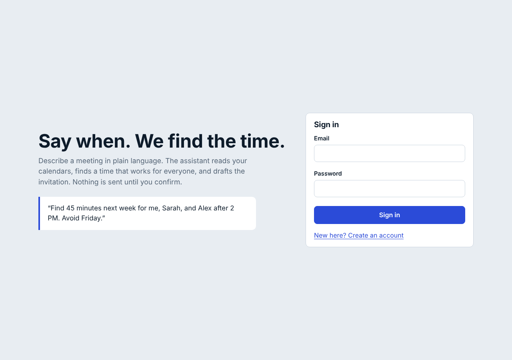

### Invalid credentials error
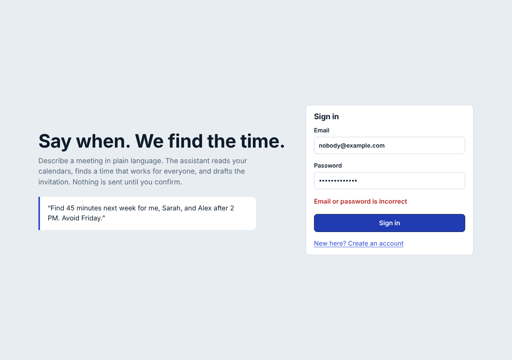

### Registration
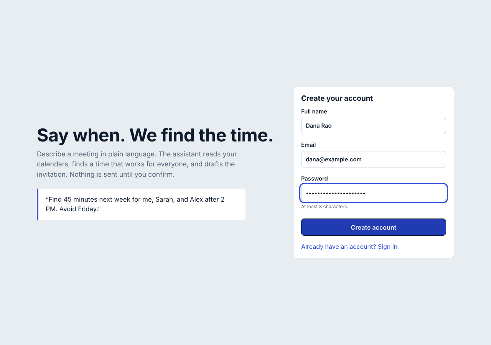

### Assistant before connecting Google Calendar
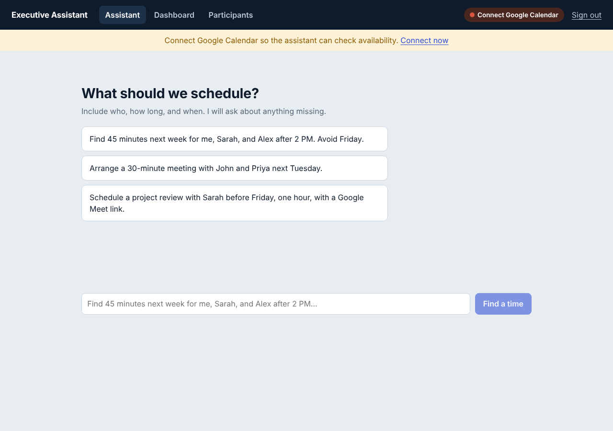

### Connected, empty assistant with example prompts
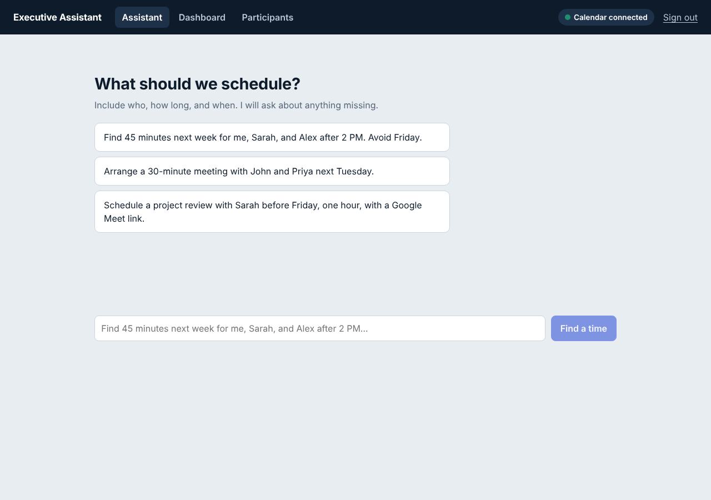

### Parsed requirements + top 3 recommended slots with timelines
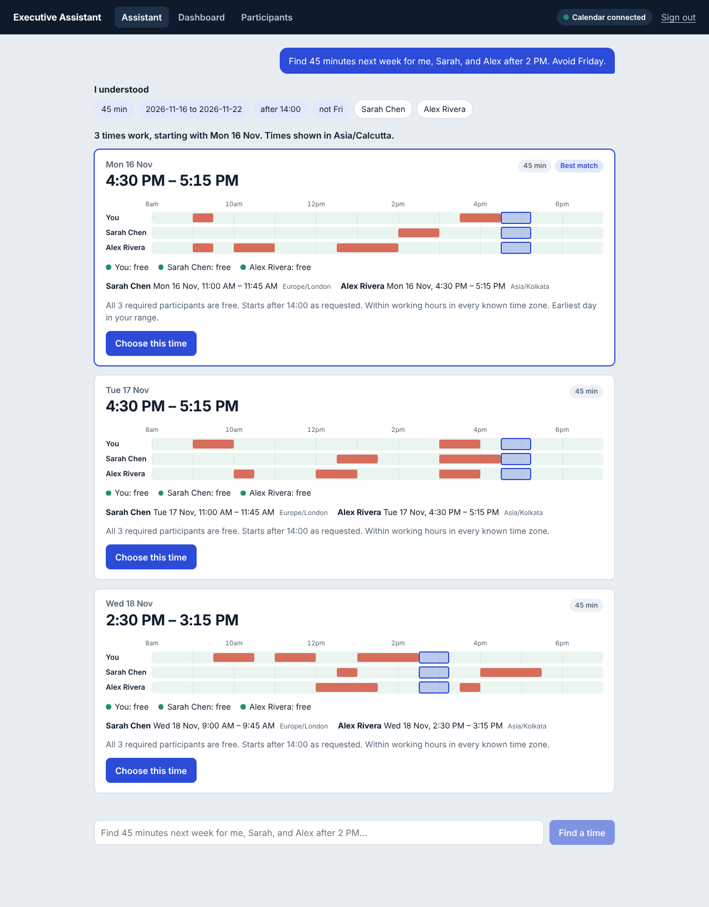

### Invitation preview and edit (nothing sent yet)
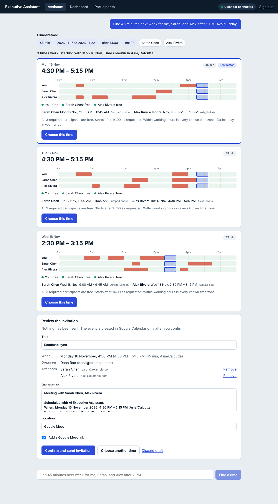

### Confirmation success with Calendar and Meet links
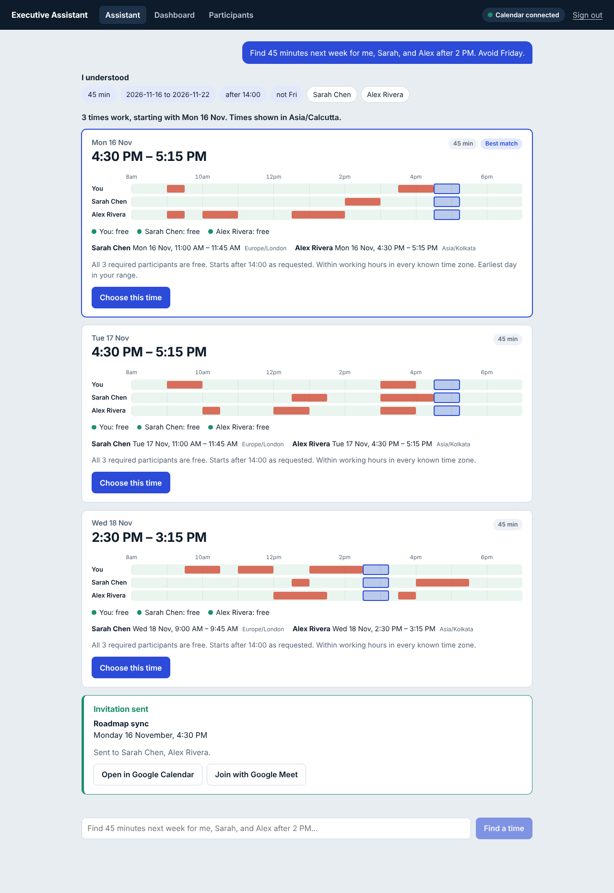

### Clarification questions for an incomplete request
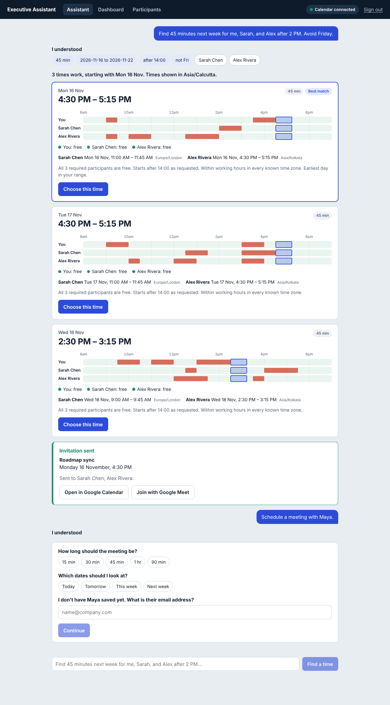

### Dashboard
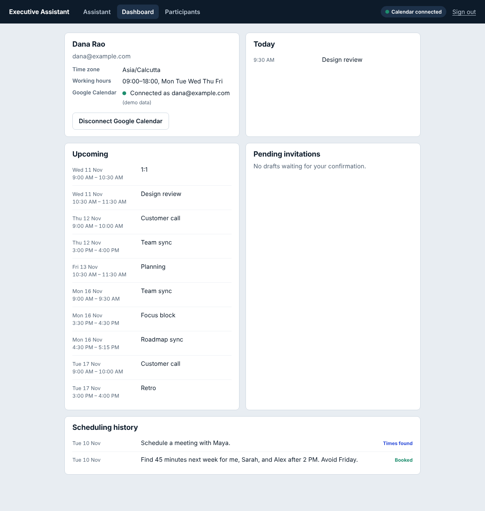

### Participant management
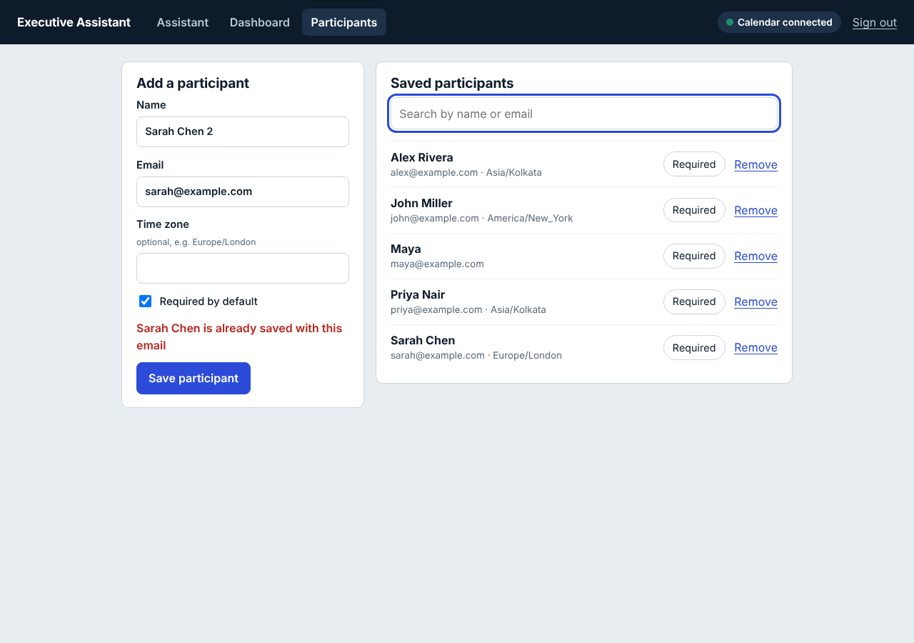

### Scheduling blocked while disconnected
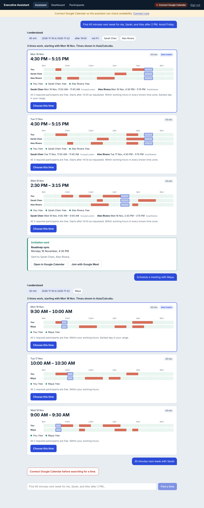

### Mobile layout (390px)
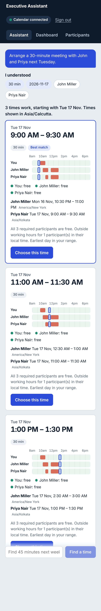

## Not covered

* Live Google OAuth/Calendar and live LLM calls (no credentials in the build environment); both are covered by stubbed-`fetch` tests.
* Persistent database (in-memory store in the MVP).
* Load/performance and cross-browser testing (Chromium only).
